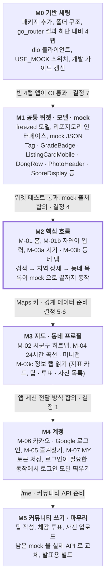

# 워케이션맵 모바일 구현 플랜

2026-11-08 · 팀 아카츠키

## 목표와 범위

이번 구현의 목표는 Figma 04 Mobile v2 행(M-01~M-07)을 workation-mobile 에 옮겨, 백엔드 API 가 붙으면 바로 실데이터로 도는 앱을 만드는 것이다. 디자인 토큰·서체·CI 는 이미 main 에 있으므로(PR #1) 공통 기반부터 시작한다.

**넣는 것**

- 공통 기반: 라우팅, 하단 내비, API 클라이언트, mock 데이터 계층, 공용 위젯
- M-01 홈(자연어 검색 진입 + 추천 목록), M-01b 자연어 검색 입력
- M-02 지도, M-03 지역 상세, M-04 동네 프로필
- M-05 즐겨찾기, M-06 로그인, M-07 마이페이지

**빼는 것 (2차)**

- 동네 비교(W-05), 지자체 리포트(W-06) — 웹 전용
- 신고, 공유 카드 생성 — 팁·사진 작성과 체감 투표는 Figma M-03c·M-04 에 있으므로 넣되 마지막 단계(M5)로 미룬다
- 푸시 알림, 다크 모드, 태블릿 레이아웃

## 현재 상태

디자인과 API 명세는 준비됐고, 앱 코드와 백엔드 엔드포인트는 아직 없다. 그래서 초반은 mock 으로 화면을 만들고, API 가 열리는 대로 바꾼다.

| 항목 | 상태 | 위치 |
| --- | --- | --- |
| 모바일 레포 | Flutter 3.47 뼈대 + 디자인 토큰·서체·Material 3 테마 적용. 화면은 토큰 확인용 샘플 1개, 패키지는 cupertino_icons 뿐 | `lib/core/theme/`, PR #1 |
| CI | format · analyze · test (Flutter 3.47.4) | `.github/workflows/ci.yml` |
| 디자인 | 04 Mobile v2 행에 9화면: M-01, M-01b, M-02, M-03a/b/c(시기·동네·정보 탭), M-04, M-05, M-06, M-07 | Figma `QulBXJPP2qYhRhh8lGzT66`, 프레임 `305:5983`~`305:6817` |
| 디자인 이슈 | v2 갱신 항목 반영 완료(웹 v2 스펙 결정에 맞춤). 하단 내비는 현재 4탭 유지로 결정 | #2 (닫힘) |
| API 명세 | OpenAPI 0.4.0, 명세 v0.3 · DB 기준. 기본 주소 `/api/v1`. 웹 스펙이 추가한 `/regions/popular`, `/api/auth/*`, `/api/me/settings` 는 아직 미반영 | workation-docs `명세/api/openapi.yaml` |
| 백엔드 | Django 초기 세팅(모델 5개, Docker). 엔드포인트는 `api/health` 뿐 | workation-backend #9 |
| DB | Supabase 에 지표·원천 6테이블 적재 완료, 행정동 203곳 | workation-backend `db/` |
| 웹 | W-01~W-08 첫 구현 머지(mock 데이터). 상단 내비 3탭: 지역 찾기 `/` · 랭킹 `/tier` · 동네 고르기 `/compare` | workation-web #6, `docs/superpowers/` |

웹이 이미 같은 API 계약으로 mock 을 만들고 있으므로, 지표 라벨·프리셋·등급 규칙은 웹 공통기반 스펙(`docs/superpowers/specs/2026-11-06-공통기반-design.md`) 5장을 그대로 따른다.

## 기술 구성

웹이 고른 구조(서버 상태 캐시 + mock 스위치 + URL 상태)를 Flutter 에서 같은 역할의 패키지로 맞춘다. 두 클라이언트가 같은 계약·같은 mock 흐름을 쓰면 백엔드가 한 번만 맞추면 된다.

| 역할 | 제안 패키지 | 웹의 대응 | 이유 |
| --- | --- | --- | --- |
| 상태·서버 캐시 | flutter_riverpod | TanStack Query | 비동기 상태(로딩·에러·데이터)와 의존성 주입을 한 번에. mock 교체는 provider override 한 줄 |
| 라우팅 | go_router | React Router + URL 쿼리 | 하단 내비 탭별 스택(StatefulShellRoute), 공유 링크 딥링크 |
| HTTP | dio | fetch 래퍼 `api<T>()` | 인터셉터로 토큰 부착·에러 변환 |
| 모델 | freezed + json_serializable | TS 타입 | OpenAPI 스키마를 불변 모델로. 계약이 바뀌면 빌드가 깨진다 |
| 지도 | google_maps_flutter | Google Maps JS | 아키텍처 문서 결정(클라이언트 직접 호출). 히트맵은 경계 Polygon 에 heat 토큰 색 |
| 차트 | fl_chart | (웹 차트 라이브러리) | 월별 막대(M-03a), 24시간 곡선 주중·주말(M-04) |
| 이미지 | cached_network_image | `` | Cloudflare 사진 URL 캐시 |
| 로컬 저장 | shared_preferences, flutter_secure_storage | localStorage | 최근 검색어 / 인증 토큰 |
| 공유 | share_plus | Web Share | M-03·M-04 공유 버튼 |
| 테스트 | flutter_test + mocktail | Vitest + Playwright | 로직은 단위, 화면은 mock provider 로 위젯 테스트 |

로그인은 웹(W-07)과 같은 백엔드 OAuth 리다이렉트를 쓰므로 카카오·Google SDK 를 앱에 넣지 않는다. 인앱 브라우저로 백엔드 시작 URL 을 열고 딥링크로 돌아오는 방식이며(flutter_web_auth_2 후보), 앱이 세션을 받는 방법은 결정 사항 1번에서 백엔드와 정한다.

**폴더 구조** — 현재 README 의 `features/<화면>` 규칙을 유지하고, 여러 화면이 같이 쓰는 모델·리포지토리만 `data/` 로 뽑는다.

```
lib/
  app/            app.dart, router.dart, shell(하단 내비)
  core/
    theme/        (있음) 토큰·테마
    network/      api_config.dart(USE_MOCK 추가), dio_client.dart, api_exception.dart
    metric/       지표 키·라벨·프리셋·등급 (웹 features/metric 과 동일 규칙)
  data/
    models/       region, dong, search, map, tip, vote, photo, me (freezed)
    repositories/ *_repository.dart (추상) + api_*.dart + mock_*.dart
  features/
    home/ search/ map/ region/ dong/ favorites/ auth/ my/
      *_screen.dart, widgets/, *_providers.dart
  shared/widgets/ Figma 공통 컴포넌트와 1:1
assets/mock/      응답 JSON (데이터 분석 결과로 생성)
```

mock 스위치는 `--dart-define=USE_MOCK=true`. 기본값은 백엔드가 열리기 전까지 true 로 둔다.

## 디자인 시스템

토큰은 이미 `lib/core/theme/` 에 Figma 와 1:1 로 들어와 있어 새로 옮길 것은 없다. 남은 일은 v2 화면에 쓰인 Figma 컴포넌트를 `shared/widgets/` 에 같은 이름으로 만드는 것이다. 색은 `AppSemanticColors`, 글자는 `AppTextStyles` 만 쓴다(README 규칙).

| 위젯 | 쓰는 화면 | 메모 |
| --- | --- | --- |
| `Tag` | M-01, M-01b, M-03, M-04, M-07 | AI 조건 칩, 지역 속성 태그 |
| `GradeBadge` | M-01, M-02, M-03 | S·A·B·C, `gradeOf()` 이미 있음 |
| `ListingCardMobile` | M-01, M-05 | 사진 캐러셀 + 즐겨찾기 버튼 + 점수. Meta2 선택 표시 |
| `DongRow` | M-03b, M-05 | 행정동 한 줄 요약 |
| `Mobile/BottomNav` | M-01, M-02, M-05, M-07 | 홈 · 지도 · 즐겨찾기 · MY 4탭 (결정 사항 2번) |
| `MobileStickyBar` | M-03, M-04 | 점수 요약 + 즐겨찾기 CTA |
| `PhotoHeader` | M-03, M-04 | 사진 캐러셀 + 뒤로·공유·저장 (Figma 는 frame, 컴포넌트화 필요) |
| `ScoreDisplay` | M-03 | 64px 종합 점수 + 순위 문구 |
| `Mobile/SegmentedTabs`, `DayToggle` | M-03, M-04 | 시기·동네·정보 / 주중·주말 |
| `MetricCard` | M-03c, M-04 | 지표 5종 카드 |
| `SearchPillMobile`, `CategoryTab` | M-01 | 검색 진입, 카테고리 스트립 |
| `Chip`, `HeatLegend`, `PhotoThumb` | M-02, M-03b | 지표 선택, 범례 |
| `TipCard`, `TipComposer`, `ReactionPoll` | M-03c, M-04 | 읽기는 M3, 쓰기는 M5 |
| `UserPhotoTile`, `PhotoUploadTile` | M-03c, M-07 | 업로드는 M5 |
| `Avatar`, `SocialLoginButton`, `Button` | M-05~M-07 | |

차트 두 종(월별 혼잡 지수, 24시간 붐빔 곡선)은 화면 전용이라 `features/region/widgets/`, `features/dong/widgets/` 에 둔다. 각 위젯은 만들 때 Figma 컴포넌트 스크린샷과 위젯 테스트 1개를 같이 낸다.

## 화면별 구현 메모

화면과 API 대응은 workation-docs `명세/api/README.md` 의 화면별 API 표를 따르되, 웹 스펙(workation-web `docs/superpowers/specs/`)이 더 최신인 경로는 웹을 따른다. 하단 탭은 홈(`/`) · 지도(`/map`) · 즐겨찾기(`/favorites`) · MY(`/my`) 4개다.

| 화면 | 라우트 | 핵심 구성 | API | 단계 |
| --- | --- | --- | --- | --- |
| M-01 홈 | `/` | 검색 필, 카테고리 스트립, AI 조건 칩 + 조건 수정, 프리셋·정렬(즐겨찾기·조회·종합 점수순), 인기 지역 12곳 카드 | `POST /search/nl`, `GET /regions/popular` (웹 W-01 v4) | M2 |
| M-01b 자연어 입력 | `/search` | 질문 입력, 조건 미리보기 태그, 예시 질문, 추천 받기 CTA | `POST /search/nl` | M2 |
| M-02 지도 | `/map` | 지표 선택 칩, 시군구 히트맵, 범례, 선택 지역 바텀시트 | `GET /map/scores?level=region` | M3 |
| M-03a 지역 상세 · 시기 | `/regions/:id?tab=season` | 사진 헤더, 종합 점수, 월별 혼잡 지수 막대, 좋은 달·피할 달·주말 차이 | `GET /regions/{id}`, `/months` | M2 |
| M-03b · 동네 | `?tab=dongs` | 정렬 칩, 행정동 목록 | `GET /regions/{id}/dongs` | M2 |
| M-03c · 정보 | `?tab=info` | 지표 카드 5개, 추천 이유, 외부 링크, 팁·투표·사진 | `GET /tips`, `/votes`, `/photos` | M3 (쓰기 M5) |
| M-04 동네 프로필 | `/dongs/:id` | 월 선택 + 주중·주말, 24시간 곡선, 지표 카드 4개, 미니맵, 팁·투표 | `GET /dongs/{id}`, `/tips`, `/votes` | M3 (쓰기 M5) |
| M-05 즐겨찾기 | `/favorites` | 지역 카드 + 동네 목록. 로그인 필수(비로그인이면 로그인 모달) | `GET·PUT·DELETE /me/favorites` | M4 |
| M-06 로그인 | `/login` (모달) | 카카오·Google 버튼(Apple 제외), 둘러보기 | `GET /api/auth/{provider}/start` → 딥링크 복귀, `GET /api/auth/me` (웹 W-07) | M4 |
| M-07 MY | `/my` | 프로필, 활동 통계, 내 팁·사진 탭, 알림 설정 토글 3개, 연결된 계정, 로그아웃 | `GET·PATCH·DELETE /me`, `/me/tips`, `/me/photos`, `PATCH /api/me/settings` (웹 W-08) | M4 |

지역 상세의 세 탭은 한 화면(`RegionScreen`)의 탭으로 만들고, 사진 헤더·점수는 스크롤 시 접히는 `NestedScrollView` 로 둔다. M-04 곡선은 v2 에서 11시 피크로 다시 그렸으므로 Figma v2 를 기준으로 한다.

## API·데이터 의존성

백엔드는 `api/health` 만 있으므로, 모든 화면은 OpenAPI 0.4.0 을 따르는 mock 리포지토리로 먼저 만든다. 실제 API 가 열리면 화면 코드는 그대로 두고 provider 만 바꾼다.

1. 리포지토리 인터페이스를 OpenAPI 경로 단위로 정의한다 (`RegionRepository.rank()`, `.detail()`, `.months()`, `.dongs()` 등).
2. `MockXxxRepository` 는 `assets/mock/*.json` 을 읽어 200ms 지연 후 반환한다. 웹 mock 과 같은 수치를 쓰도록, 웹이 정한 생성 스크립트에서 JSON 을 뽑는다(결정 사항 4번).
3. `ApiXxxRepository` 는 dio 로 `API_BASE_URL` + `/api/v1` 을 호출한다. 접두사를 어디서 붙일지는 웹과 같이 정한다.
4. 엔드포인트가 하나 열릴 때마다 해당 리포지토리만 실제 구현으로 바꾼다. `USE_MOCK` 은 전체 스위치, 개별 교체는 provider override 로 한다.

백엔드에 먼저 요청할 순서는 화면 단계와 같다: `/regions/popular`·`/regions/{id}`·`/months`·`/dongs` → `/search/nl` → `/map/scores`·`/dongs/{id}` → `/me`·`/me/favorites` → 커뮤니티. 지도용 시군구 경계 GeoJSON 을 API 로 받을지 앱에 번들할지도 백엔드와 정해야 한다(12곳이라 번들도 가능).

## 단계별 마일스톤

여섯 단계로 나누고, M2 가 끝나면 발표에서 보여줄 핵심 흐름이 mock 으로 돈다. 각 단계는 화면 하나 또는 위젯 묶음 단위 이슈·PR 로 자른다(브랜치 `feat/M-02-map` 형식).



화살표 위 문구는 다음 단계로 넘어가는 조건이다. 날짜는 팀 일정 확정 후 기입한다. M3 과 M4 는 서로 의존하지 않아, 사람이 둘이면 동시에 진행할 수 있다.

**먼저 열 이슈 (M0·M1)**

- [ ] chore: 패키지 추가와 폴더 구조 정리 (riverpod, go_router, dio, freezed)
- [ ] feat: go_router 셸과 하단 내비 4탭
- [ ] feat: dio 클라이언트 + `USE_MOCK` 스위치 + 에러 변환
- [ ] feat: OpenAPI 0.4.0 기준 모델과 리포지토리 인터페이스
- [ ] feat: mock JSON 과 Mock 리포지토리 (지역·동네·검색)
- [ ] feat: 공통 위젯 1차 (Tag, GradeBadge, ListingCardMobile, DongRow, PhotoHeader, ScoreDisplay, SegmentedTabs, MobileStickyBar)
- [ ] docs: 개발 가이드에 상태관리·라우팅·mock 규칙 추가

## 결정이 필요한 것과 리스크

M0 을 시작하는 데 막히는 것은 없다. 7번은 M0 전에, 나머지는 해당 단계 전에 정하면 된다. 2·3번은 결정됐고, 1번은 웹 결정 위에 앱 세션 전달 방식만 남았다. 명세 · 디자인 원칙 · Figma 를 이 결정에 맞추는 일은 workation-docs #9 에서 한다.

| # | 항목 | 충돌 / 선택지 | 제안 | 필요 시점 |
| --- | --- | --- | --- | --- |
| 1 | 로그인 방식 | **웹 W-07 이 결정**: 백엔드 OAuth 리다이렉트(카카오·Google), 세션은 HttpOnly 쿠키, 프론트에 SDK·키 없음. API README 의 "클라이언트 Supabase Auth SDK" 는 옛 기준. **모바일도 Apple 제외**(2026-11-08 결정): 시연 빌드까지만 만들고 App Store 에 출시하지 않으므로 심사 가이드라인 4.8 해당 없음. 출시하게 되면 다시 검토 | 앱도 같은 흐름. 인앱 브라우저로 `/api/auth/{provider}/start?redirect=<앱 딥링크>` 를 열고 복귀. 쿠키를 앱이 직접 쓰기 어려우므로 복귀 시 일회용 코드 → 토큰 교환 같은 앱용 전달 방식을 백엔드와 합의 | M4 전 |
| 2 | 하단 내비 | **결정됨 (2026-11-08)**: 웹은 첫 구현에서 3탭(지역 찾기 W-01 · 랭킹 W-02 · 동네 고르기 W-05)으로 확정, 워케이션 노트 탭 제거 | 모바일은 홈 · 지도 · 즐겨찾기 · MY 4탭 유지. 웹의 지역 찾기는 홈 · 지도와 겹치고, 랭킹(티어리스트)과 동네 비교는 웹 전용 — 모바일은 홈 프리셋 · 정렬과 지도 지표 칩으로 대신 | — |
| 3 | 즐겨찾기 저장 | **결정됨 (웹 W-08)**: 로그인 필수, 비로그인 기기 저장·병합 없음. Figma M-05 v2 문구도 맞춤(#2) | 웹과 동일. 비로그인 하트 → 로그인 모달 | — |
| 4 | mock 데이터 출처 | 웹은 `.ts` mock, 생성 스크립트 위치 미정 | workation-data 에 스크립트를 두고 JSON 을 낸 뒤 웹·모바일이 같이 씀 | M1 |
| 5 | 지도 경계 데이터 | API 로 받기 vs 앱 번들 | 시군구 12곳은 번들, 행정동은 API | M3 |
| 6 | Google Maps 키 | 발급·패키지 제한 담당 미정 | Android `com.skpjc.workation_mobile`, iOS `com.skpjc.workationMobile` 로 제한 | M3 |
| 7 | 상태관리 패키지 | Riverpod 제안을 팀이 다룰 수 있는지 | 모바일 담당과 합의 후 개발 가이드에 기록 | M0 |

**리스크**

- 백엔드 일정: 엔드포인트가 늦으면 발표 때까지 mock 으로 돌아갈 수 있다. 그래서 mock 수치를 실제 분석 결과에서 뽑는다.
- 사진 저작권: 시안 사진은 저작권 확인 전에 스토어·배포 빌드에 넣지 않는다(웹과 같은 규칙).
- 네이티브 설정: 지도·소셜 로그인은 iOS·Android 각각 키·스킴 설정이 필요하고 iOS 빌드는 macOS 에서만 된다. M3·M4 첫 이슈로 따로 떼어 둔다.
- 자연어 검색 응답 시간: LLM 호출이 수 초 걸린다. M-01b 에 로딩·취소·실패 상태를 처음부터 넣는다.
